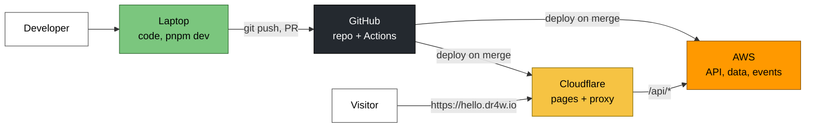
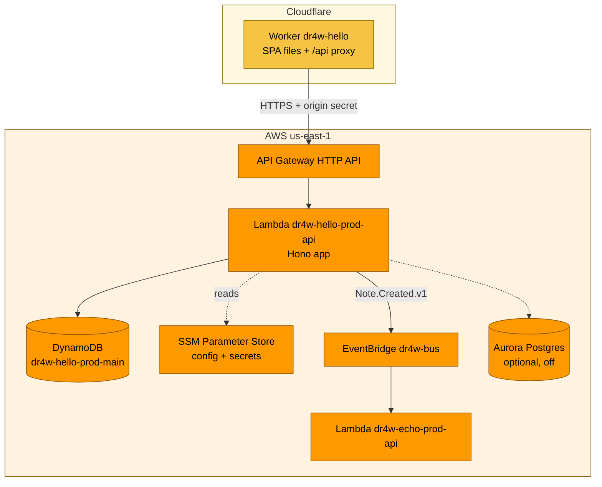
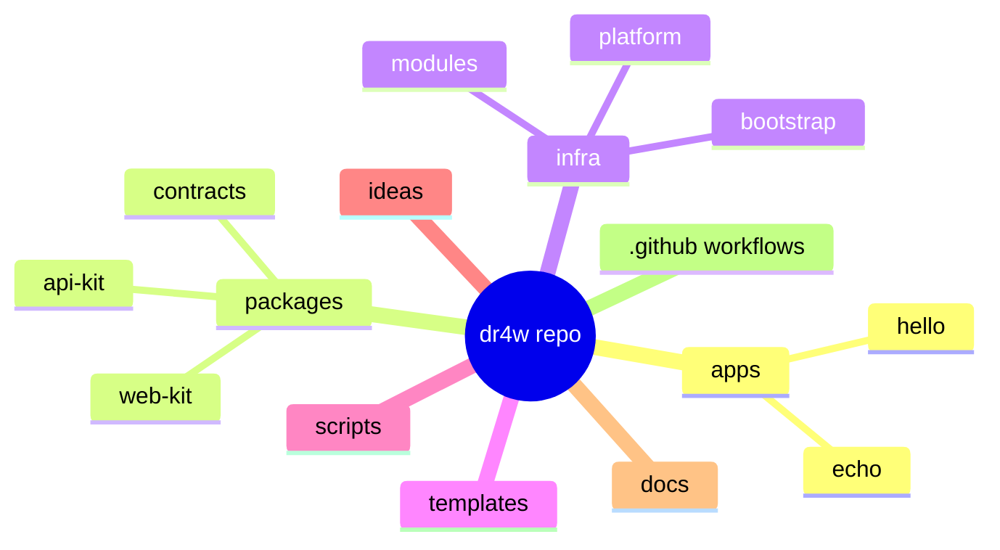

# 02 · The big picture

> **In one sentence:** code goes from your laptop to GitHub, GitHub deploys it to Cloudflare and AWS, and users reach it through `<name>.dr4w.io`.
> **Reading time:** ~7 min · **Level:** 🟢 beginner-friendly, 🔵 expert section marked

## Why this matters
Before zooming into any part, you need a mental map: who talks to whom, and where each piece runs.
Every later chapter is a close-up of one box on these diagrams.

## The idea, simply
There are four places things happen:
1. **Your laptop** — where you write and test code.
2. **GitHub** — where the code is stored and where robots check and deploy it.
3. **Cloudflare** — a network of servers close to users; it serves the web pages.
4. **AWS (Amazon Web Services)** — rented computers and databases; it runs the API and stores data.

Users only ever see Cloudflare. Cloudflare quietly forwards data requests to AWS.

Names you'll meet below (each gets its own chapter): **Lambda** runs your API code on demand,
**API Gateway** is its front door, **DynamoDB** is the database, **SSM Parameter Store** (AWS
Systems Manager) holds settings and secrets, and **EventBridge** carries events between projects.

### Legend (same colors in every diagram)
🟧 AWS · 🟨 Cloudflare · ⬛ GitHub · 🟩 your laptop · ⬜ people

## How it works in dr4w

**System context** — notice that users never talk to AWS directly.


**Containers** — notice that each project gets its own Worker, API and table, but the event bus is shared.


**Repo map** — notice that projects (`apps/`) are separate from what they share (`packages/`, `infra/modules/`).


The shared platform pieces, created once (chapter 7):
- **Bootstrap:** a storage bucket for OpenTofu's record of what exists (its *state*, chapter 7), and
  the permission sets (*roles*, chapter 9) GitHub uses to deploy.
- **Platform:** the event bus `dr4w-bus`, an email list for alerts (an SNS *topic*), and a $10 monthly budget alarm.

## Try it
```bash
ls apps packages infra/modules
cat apps/hello/project.json
```
Expected: the project folders `echo` and `hello`; the packages `api-kit`, `contracts`, `web-kit`; the eight
modules (`bucket cron dynamo-table event-subscription pg-database project-api project-ref queue`);
and hello's manifest — `project.json`, a small file with its name, subdomain, which projects may
use it (`exposes`) and its local ports.

## 🔵 Expert notes
- **Same origin by design:** the browser only calls `hello.dr4w.io/api/*`; the Worker forwards to
  the API Gateway's own AWS address (the "execute-api URL") with a shared secret. No CORS, no extra DNS or certificates for the API
  (ADR `docs/decisions/0001-baseline-stack.md`). Cost: every API call takes an extra hop through the Worker.
- **Isolation unit = project:** one Worker, one Lambda, one table, one state file per project
  (`projects/<p>/prod/terraform.tfstate`). A broken project can't break another's deploy.
- **Shared account:** everything runs in one AWS account that also hosts other work; isolation is
  by `dr4w-*` naming and IAM boundaries (`docs/decisions/0003-single-shared-aws-account.md`).
- Single region `us-east-1`; static files are served from Cloudflare's edge worldwide, API calls travel to Virginia.

## Common mistakes
- Calling the AWS URL from the browser — see `docs/dos-and-donts.md` → Frontend.
- Assuming the event bus is per project. It's shared; access is controlled by `exposes` (chapter 8).

## Check yourself
1. Which of the four places do visitors talk to?
2. What is shared between `hello` and `echo`, and what isn't?
3. Why is there a Worker in front of the API?

<details><summary>Answers</summary>

1. Only Cloudflare (`hello.dr4w.io`).
2. Shared: the event bus, alerts, budget, deploy roles. Separate: Worker, Lambda, table, state.
3. So the browser talks to one origin (no CORS) and the API only accepts requests that carry the Worker's secret.
</details>

## Learn more
`docs/architecture.md` · `docs/repo-map.md` · Cloudflare Workers: https://developers.cloudflare.com/workers/ ·
AWS overview: https://aws.amazon.com/what-is-aws/ · next: [03 · Foundations](03-foundations.md)
