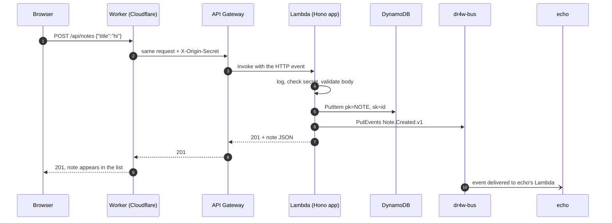

# 04 · The journey of a request

> **In one sentence:** follow one "save note" click on `hello.dr4w.io` through the Worker, API Gateway, Lambda, DynamoDB and the event bus — and back.
> **Reading time:** ~10 min · **Level:** 🟢 beginner-friendly, 🔵 expert section marked

## Why this matters
This is the anchor chapter. Every later chapter zooms into one step of this journey. If you
understand this page, you understand dr4w.

## The idea, simply
Imagine sending a letter through a building's reception. You hand it to the receptionist
(the **Worker**). The receptionist stamps it with a secret seal and passes it to the mailroom
(**API Gateway**). The mailroom gives it to the right clerk (the **Lambda**). The clerk checks the
seal, reads the letter, files it in a cabinet (**DynamoDB**), rings a bell so other departments know
(**the event bus**), and sends a receipt back the same way.

## How it works in dr4w
A visitor types a title and clicks **Add note**. Follow the arrows — notice that the browser only
ever talks to `hello.dr4w.io`, and that the secret is added by the Worker, never by the browser.



Step by step, with the real files:

1. **Browser.** `apps/hello/web/src/App.tsx` calls `api.notes.$post({ json: { title, body } })`.
   `api` is a typed client created in `apps/hello/web/src/api.ts` (Hono's client: `$post` means
   "send a POST to this path", and the editor knows which fields are allowed). It sends
   `POST /api/notes` to the **same site** the page came from.
2. **DNS + TLS.** Cloudflare owns `dr4w.io`, so `hello.dr4w.io` resolves to Cloudflare's edge and
   uses a certificate Cloudflare issued automatically.
3. **Worker.** Requests under `/api/*` run the Worker first (`run_worker_first` in
   `apps/hello/web/wrangler.jsonc`, the config file for **wrangler**, Cloudflare's deploy tool). `apps/hello/web/worker/index.ts` copies the request headers,
   sets `x-origin-secret` to the real value from its secret store (overwriting anything the
   client sent), and forwards it to
   `API_ORIGIN` — the API Gateway address set at deploy time. Any other path is served from the
   built static files (the SPA).
4. **API Gateway.** The HTTP API has one catch-all route that hands every request to the
   Lambda. It also throttles: at most 50 requests per second, bursts of 100
   (`infra/modules/project-api/main.tf`).
5. **Lambda entry.** `apps/hello/api/src/lambda.ts` exports
   `createLambdaHandler(app, events)` from `packages/api-kit/src/events.ts`. It sees an HTTP event
   (not a bus event) and passes it to the Hono app.
6. **Middleware.** `apps/hello/api/src/app.ts` runs, in order: `requestLogger()` (one JSON log
   line), then `originSecret()` — it compares the header with the secret read from SSM in
   *constant time* (always the same duration, so an attacker can't guess it character by
   character from response times); a mismatch returns `403` and stops here.
7. **Route + validation.** `.route('/notes', notes)` sends it to
   `apps/hello/api/src/routes/notes.ts`. `validate('json', CreateNote)` checks the body against
   the zod schema in `packages/contracts/src/hello.ts`; bad input returns `400`.
8. **Data.** `createNote()` in `apps/hello/api/src/data/notes.ts` writes one item to the table
   `dr4w-hello-prod-main` (`pk = "NOTE"`, `sk = <uuid>`) — a DynamoDB *PutItem*, i.e. "write one record".
9. **Event.** `publish(NoteCreatedV1, …)` from `packages/api-kit/src/publish.ts` puts a
   `Note.Created.v1` event on `dr4w-bus` (*PutEvents* = "send events to the bus").
10. **Response.** The route returns `201` with the note as JSON; it travels back through API
    Gateway and the Worker to the browser, and React adds it to the list.
11. **Side effect.** EventBridge matches echo's rule and invokes echo's Lambda, which increments
    its counter (chapter 8). The visitor doesn't wait for this.

## Try it
```bash
pnpm dev hello
curl -s -X POST localhost:5173/api/notes -H 'content-type: application/json' -d '{"title":"from curl"}'
curl -s localhost:8787/api/notes -o /dev/null -w '%{http_code}\n'
```
Expected: the first call returns `201` with a note — port 5173 is the local Worker, like the
real site; the second returns `403` — port 8787 is the API itself, without the Worker in front, and — calling the API directly, without the Worker's secret, is refused. Stop `pnpm dev` with Ctrl-C.

## 🔵 Expert notes
- **Latency budget:** edge → `us-east-1` round trip + API Gateway + Lambda + one DynamoDB write +
  one `PutEvents`. Publishing is awaited, so the event cost is on the request path. A failed
  `PutEvents` fails the request after the note was saved — no outbox yet — and a client that retries
  then creates a *duplicate* note with a new id.
- **Cold start:** a 1.3 MB esbuild bundle on Node 24 arm64 with 512 MB memory. The first request
  after idle also loads the origin secret from SSM. Not yet measured; to measure:
  `aws logs filter-log-events --log-group-name /aws/lambda/dr4w-hello-prod-api --filter-pattern '"Init Duration"'`.
- **Failure points:** a rotated secret (Lambda re-reads SSM at most once a minute,
  `docs/decisions/0007-origin-secret-in-ssm.md`); throttling returns `429` from API Gateway; a
  Worker without `API_ORIGIN` returns `503 api_not_configured`.
- **Same code locally:** `pnpm dev` runs the same Worker (workerd) and the same Hono app (Node),
  only with dynamodb-local and local event delivery (chapter 11).

## Common mistakes
- Adding auth checks in the browser — the trust boundary is the Worker → API secret (`docs/security.md`).
- Validating input by hand instead of with shared zod schemas (`docs/dos-and-donts.md` → API).

## Check yourself
1. Where is the origin secret added, and where is it checked?
2. What happens to a request with an invalid body?
3. Does the visitor wait for `echo` to update its counter?

<details><summary>Answers</summary>

1. Added by the Worker (`web/worker/index.ts`); checked by `originSecret()` in the Lambda.
2. `validate('json', CreateNote)` rejects it with `400` before any data is written.
3. No. The event is published during the request, but echo processes it separately.
</details>

## Learn more
`docs/architecture.md` §2 · Hono on Lambda: https://hono.dev/docs/getting-started/aws-lambda ·
Workers static assets: https://developers.cloudflare.com/workers/static-assets/ ·
next: [05 · Worker, Lambda and contracts](05-application.md)
