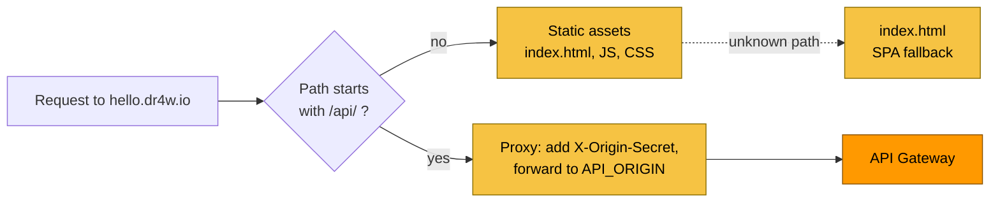
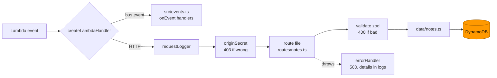

# 05 · The application: Worker, Lambda and contracts

> **In one sentence:** each project is a React app served by a Cloudflare Worker that forwards `/api/*` to one Hono app running on AWS Lambda, with request and response shapes shared through zod schemas.
> **Reading time:** ~12 min · **Level:** 🟢 beginner-friendly, 🔵 expert section marked

## Why this matters
This is the code you write every day. Knowing which piece does what tells you where a new
feature goes and why some rules (like "never call AWS from the browser") exist.

## The idea, simply
- The **web app** is the shop window: React draws the page in the browser.
- The **Worker** is the shop door: it hands out the window display (static files) and walks
  customers' orders to the back office, adding a staff badge (the origin secret) on the way.
- The **Lambda** is the back office clerk who only wakes up when an order arrives. It runs a
  **Hono** app — a small web framework that maps URLs to functions.
- **Contracts** are the order forms both sides agree on: zod schemas say exactly what a note
  looks like, and both the web app and the API use the same definition.

## How it works in dr4w

### The Worker
`apps/hello/web/worker/index.ts` decides per request — notice that only `/api/*` reaches AWS.

Configuration is in `apps/hello/web/wrangler.jsonc`: the Worker name `dr4w-hello`, the custom
domain `hello.dr4w.io`, `not_found_handling: "single-page-application"` (unknown paths get
`index.html`) and `run_worker_first: ["/api/*"]`. `API_ORIGIN` is injected at deploy time; the
secret `ORIGIN_SECRET` is uploaded with the same deploy (chapter 11).

### The web app
`apps/hello/web/src/App.tsx` is plain React. It never builds URLs by hand: `apps/hello/web/src/api.ts`
creates a client that knows the API's routes and data shapes (`createApi<AppType>()` in
`packages/web-kit`; the `<AppType>` part hands it the API's type description).
If the API changes a route or a response field, the web app stops compiling instead of failing at runtime.
(That protects the build only: after a deploy, browsers may still run the previous app for a while,
and the Lambda is deployed before the Worker — so keep API changes backward-compatible.)

### The Lambda and Hono
One Lambda per project (`dr4w-hello-prod-api`) runs one Hono app. Its code is built into one file
and uploaded through an S3 bucket at deploy time. Notice that every request passes
the same middleware before reaching a route.

- `apps/hello/api/src/app.ts` builds the app: `basePath('/api')`, the two middlewares, and one
  `.route()` line per resource. Adding an endpoint is a new route file plus one line here — never a
  new Lambda (`docs/guides/new-endpoint.md`).
- `apps/hello/api/src/lambda.ts` is the cloud entry; `apps/hello/api/src/local.ts` runs the
  same `app` on Node for `pnpm dev`. Only the adapter differs.
- Shared helpers live in `packages/api-kit/src/`: `origin-secret.ts`, `errors.ts`, `log.ts`,
  `ddb.ts` (DynamoDB client), `publish.ts` (events), `events.ts` (event dispatch).
- `apps/hello/api/src/env.ts` reads environment variables once, through a zod schema, and fails fast if one is missing.

### Contracts
`packages/contracts/src/hello.ts` defines `Note`, `CreateNote` and `UpdateNote` with zod. The API
validates with them; the web app gets the inferred TypeScript types; events reuse them
(`packages/contracts/src/events/hello.ts`).

## Try it
Change the shared schema locally and watch the web app catch it:
```bash
pnpm --filter hello-api test
pnpm --filter hello-web typecheck
```
Expected: both pass. Then, as an experiment, rename the `title` field of `Note` to `name` in
`packages/contracts/src/hello.ts` (and in its `.pick({ title: true, … })` for `CreateNote`) and
rerun `pnpm --filter hello-web typecheck` — it fails in `App.tsx`, which still uses `title`.
(`.pick({ title: true })` is zod for "take only these fields from `Note`".) Undo with `git checkout packages/contracts/src/hello.ts`.

## 🔵 Expert notes
- **Lambdalith:** one function per project, routing in Hono. Pros: fixed infra per project, shared
  cold-start cost, one IAM role. Cons: one memory/timeout setting for everything (512 MB, 10 s),
  and all routes share the role's permissions. Revisit per ADR `docs/decisions/0001-baseline-stack.md`.
- **Typed client trade-off:** the explicit `.route()` mount keeps `hc<AppType>` inference working;
  filesystem auto-routing would lose it (`docs/decisions/0006-explicit-route-mounting.md`). The web
  package type-checks the API's source, so it needs Node types too.
- **Origin secret:** constant-time compare of SHA-256 digests; cached per container and re-read on
  mismatch at most once a minute (`packages/api-kit/src/origin-secret.ts`). It authenticates *the
  Worker*, not users — there is no user auth in v1.
- **Errors:** `HTTPException` → its own response; `ZodError` → 400; anything else → 500 with a
  generic body and the stack only in logs (`packages/api-kit/src/errors.ts`).
- **Bundle:** esbuild, ESM, minified, source maps on, AWS SDK bundled rather than taken from the
  runtime (`scripts/build-lambda.ts`); Lambda reads it from S3 (`docs/decisions/0010-lambda-code-via-s3.md`).

## Common mistakes
- A new Lambda for a new endpoint — `docs/dos-and-donts.md` → API.
- Schemas defined inside a route file — the web app can't share them.
- Reading `process.env` directly instead of `src/env.ts`.

## Check yourself
1. Which requests does the Worker forward to AWS?
2. What two things happen to every HTTP request before it reaches a route?
3. Why does renaming a schema field break the web app's build?

<details><summary>Answers</summary>

1. Only paths starting with `/api/`; everything else is served from static files.
2. It is logged (`requestLogger`) and its origin secret is checked (`originSecret`).
3. The web app's client is typed from the API's own types and the shared zod schema, so the mismatch is a compile error.
</details>

## Learn more
`docs/conventions.md` (code, errors, logs) · Hono: https://hono.dev · zod: https://zod.dev ·
Hono RPC client: https://hono.dev/docs/guides/rpc · next: [06 · Data](06-data.md)
