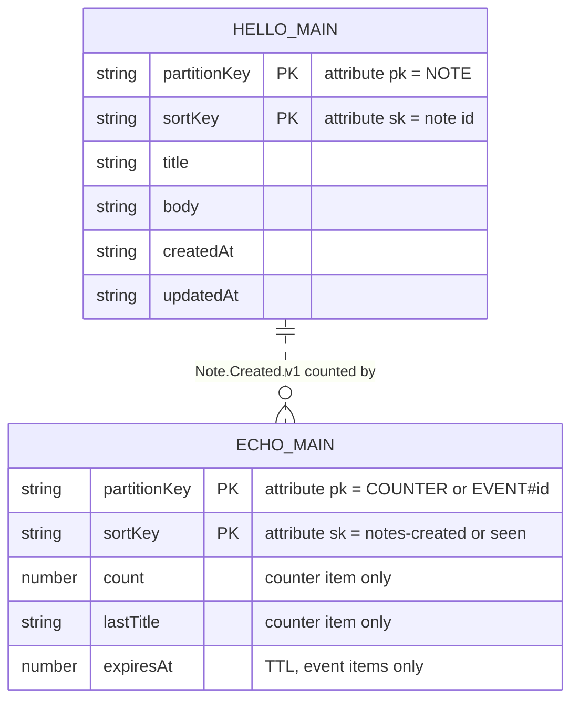

# 06 · Data

> **In one sentence:** every project stores its data in its own DynamoDB table, whose key layout is written once in `tables.json`; a shared Postgres database exists as an option but is off.
> **Reading time:** ~10 min · **Level:** 🟢 beginner-friendly, 🔵 expert section marked

## Why this matters
Data outlives code. Choosing how items are keyed decides which questions your app can answer
quickly — and which ones will be slow or expensive later.

## The idea, simply
DynamoDB is like a giant filing cabinet where every folder has a two-part label:
- the **partition key** (`pk`) says which drawer, e.g. `NOTE`;
- the **sort key** (`sk`) orders folders inside the drawer, e.g. the note's id.

You can grab one folder instantly if you know both labels, or flip through one drawer in order.
You can't efficiently search "all folders whose title contains *cat*" — that needs a different
label layout or a different kind of database.

**On-demand** billing means you pay per read and write and for what you store — nothing for an
empty cabinet sitting there.

## How it works in dr4w

### One file defines the table
`apps/hello/infra/tables.json` declares the keys. OpenTofu reads it to create the real table
(`module "tables"` in `apps/hello/infra/main.tf`, module `infra/modules/dynamo-table`), and
`scripts/seed.ts` reads the same file to create the local table in dynamodb-local. Because there
is only one definition, local and cloud can't drift.

### Data models
Notice that both projects use a generic `pk`/`sk` pair (shown as partitionKey/sortKey) and store different kinds of items in one table.

- **hello** (`apps/hello/api/src/data/notes.ts`): each note is an item with `pk = "NOTE"` and
  `sk = <id>`. Listing queries the `NOTE` partition and sorts by `createdAt` in memory — fine for
  small lists.
- **echo** (`apps/echo/api/src/data/counter.ts`): one counter item (`pk = "COUNTER"`), plus one
  short-lived item per event id (`pk = "EVENT#<id>"`) that expires after 7 days through DynamoDB's
  **TTL** feature (`ttlAttribute: "expiresAt"` in `apps/echo/infra/tables.json`). Both are written
  in a single **transaction**, so a redelivered event can't be counted twice.

### Names and access
Tables are named `dr4w-<project>-<env>-<key>` (`dr4w-hello-prod-main`) and have deletion
protection on. The project's Lambda gets read/write on exactly its own table — the
`iam_statements` output of `infra/modules/dynamo-table/outputs.tf`. Another project gets access
only if the owner grants it (chapter 8).

### The optional Postgres
For data that really needs SQL joins, the platform can create one shared **Aurora Serverless v2**
PostgreSQL cluster (`infra/platform/postgres.tf`, off by default) and one database per project
(`infra/modules/pg-database`). Lambdas talk to it over the **RDS Data API** (HTTP), so no network
setup is needed. It pauses after 5 idle minutes; the next query waits about 15 seconds.

## Try it
```bash
pnpm seed hello
AWS_ACCESS_KEY_ID=local AWS_SECRET_ACCESS_KEY=local aws dynamodb describe-table \
  --endpoint-url http://localhost:8100 --region us-east-1 --table-name dr4w-hello-local-main \
  --query 'Table.KeySchema'
```
Expected: `HASH pk` and `RANGE sk`, created locally from `apps/hello/infra/tables.json`.

## 🔵 Expert notes
- **Single-table, generic keys:** `pk`/`sk` let one table hold several entity types; add GSIs
  only for real access patterns. hello's in-memory sort is a known shortcut — at scale, use a
  time-ordered `sk` (e.g. `<createdAt>#<id>`, as the guestbook dry run did) or a GSI.
- **Hot partition:** all notes share `pk = "NOTE"`. On-demand absorbs a lot, but one partition has
  throughput limits (roughly 1,000 writes/s, 3,000 reads/s per partition). Shard the key if a
  project ever gets near that.
- **Idempotency pattern:** echo's `TransactWriteItems` = conditional `Put` of the event-id item +
  `ADD` on the counter. `TransactionCanceledException` ⇒ duplicate ⇒ ignored. Transactions cost 2×
  the write units of normal writes.
- **No PITR by default** (it costs per GB-month); no backups beyond DynamoDB's own durability.
  Deletion protection guards against `tofu destroy` accidents (`docs/guides/destroy-project.md`).
- **When Postgres:** relational queries, ad-hoc reporting, or strong cross-entity constraints.
  Costs storage (~$1–3/month) plus ~$0.40/month per Secrets Manager secret even when paused
  (`docs/decisions/0015-postgres-via-data-api.md`). Never deployed so far.

## Common mistakes
- Defining keys in `main.tf` or in code — `docs/dos-and-donts.md` → Data.
- Non-idempotent event handlers — EventBridge delivers at least once.
- Scanning the whole table to answer a question; design a key or GSI for it instead.

## Check yourself
1. Which file decides the key layout of a project's table, and who reads it?
2. Why does echo store an item per event id?
3. When would you turn on the shared Postgres?

<details><summary>Answers</summary>

1. `apps/<p>/infra/tables.json`; OpenTofu (via `dynamo-table`) and the local seed script.
2. To recognize redelivered events, so the counter increases only once per event.
3. When the data needs SQL joins or reporting that DynamoDB keys can't serve — accepting a small monthly storage cost and slow first queries after a pause.
</details>

## Learn more
DynamoDB core concepts: https://docs.aws.amazon.com/amazondynamodb/latest/developerguide/HowItWorks.CoreComponents.html ·
Aurora Serverless v2 auto-pause: https://docs.aws.amazon.com/AmazonRDS/latest/AuroraUserGuide/aurora-serverless-v2-auto-pause.html ·
next: [07 · Infrastructure as code](07-infrastructure-as-code.md)
