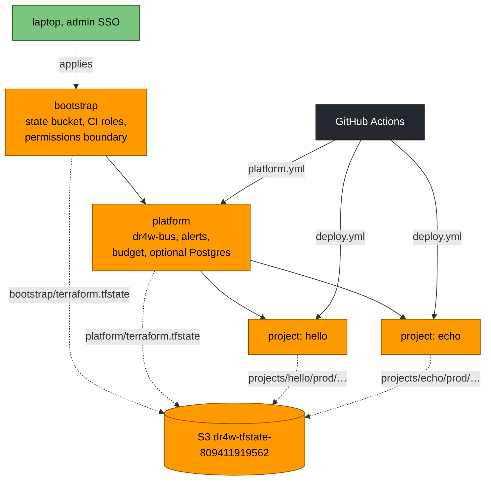
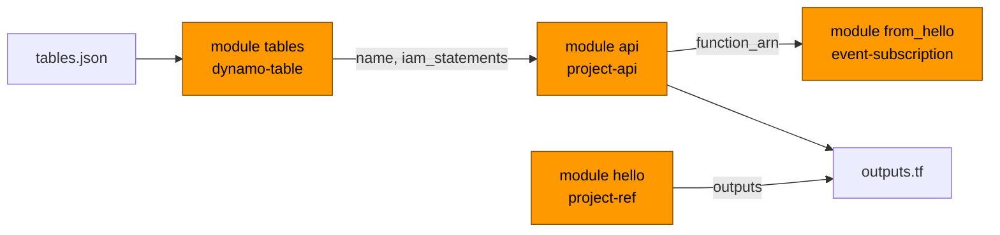

# 07 · Infrastructure as code

> **In one sentence:** all cloud resources are described in OpenTofu files, in three layers — bootstrap, platform, project — built from reusable modules, with their state kept in one S3 bucket.
> **Reading time:** ~12 min · **Level:** 🟢 beginner-friendly, 🔵 expert section marked

## Why this matters
If infrastructure is clicked together in a web console, nobody can review it, repeat it or undo
it. Writing it as code makes every change a reviewable diff and lets a new project reuse exactly
the same, already-safe building blocks.

## The idea, simply
OpenTofu works like a building plan plus a site inspector:
- the **plan files** (`.tf`) say what should exist — "a table called X, a function called Y";
- the **state** is the inspector's notebook of what was actually built last time;
- `tofu plan` compares plan, notebook and reality and lists the differences;
- `tofu apply` makes reality match the plan and updates the notebook.

A **module** is a standard component — like a prefab bathroom — that you drop into many buildings.
A **provider** is the plug-in that knows how to talk to one cloud (here: AWS).

## How it works in dr4w

### Three layers
Notice that each layer has its own state file and is changed by a different actor.

| Layer | Folder | Creates | Applied by |
|---|---|---|---|
| Bootstrap | `infra/bootstrap/` | the state bucket, the two CI roles, `dr4w-boundary` | you, once, from the laptop |
| Platform | `infra/platform/` | `dr4w-bus` + archive, `dr4w-alerts`, `dr4w-monthly` budget, optional Aurora | `platform.yml`, started by hand (GitHub → Actions → *platform* → *Run workflow*; repo admins only) |
| Project | `apps/<p>/infra/` | everything one project needs | `deploy.yml`, on merge |

All stacks share one *backend* file — where state is stored — `infra/backend.hcl` (bucket, region,
locking), and each declares only its own `key`, the file name inside the bucket. The number in the
bucket name is the AWS account ID (not a secret).

### Composing a project from modules
Notice that a project stack is just a few module blocks wired together.

That is `apps/echo/infra/main.tf` (`function_arn` is the Lambda's ARN, its unique AWS ID). `project-api` creates the Lambda, its role, the HTTP API with
throttling, a 14-day log group, two alarms, the origin secret and an S3 bucket for the code.
Every module writes its useful outputs to SSM under `/dr4w/<project>/<env>/` and returns
`iam_statements`, which the project passes to `project-api` so the Lambda gets exactly those
permissions. The full catalog is `infra/modules/README.md`.

## Try it
```bash
pnpm infra:check
```
Expected: `Success! The configuration is valid.` for `infra/bootstrap`, `infra/platform` and
each `apps/*/infra`. It runs fully offline (`scripts/infra-check.sh`).

## 🔵 Expert notes
- **Why OpenTofu:** open-source Terraform fork, stable, multi-provider; chosen over SST, CDK and
  Pulumi (chapter 14, `docs/decisions/0001-baseline-stack.md`). OpenTofu-only feature used:
  variables in the backend block (`key = "projects/hello/${var.env}/terraform.tfstate"`).
- **Locking:** native S3 lock files for *state* (`use_lockfile = true`), no DynamoDB lock table. (Not to be
  confused with `.terraform.lock.hcl`, which pins provider versions, or `pnpm-lock.yaml` for npm packages.) CI also uses a
  per-project concurrency group, so two deploys of one project never overlap.
- **State contains secrets** (the origin secrets). The bucket is versioned, encrypted, TLS-only,
  public access blocked; the deploy role can't change its settings (`infra/bootstrap/ci-roles.tf`).
- **Blast radius:** a project's state only contains that project. Bootstrap is deliberately out
  of CI's reach — CI can't widen its own permissions.
- **Provider pins:** `hashicorp/aws ~> 6.69` with lock files committed for Linux and macOS; versions in `docs/stack.md`.
- **Drift:** a few things change outside OpenTofu on purpose — the emergency stop (`aws lambda
  put-function-concurrency`, which the next deploy silently undoes), Cloudflare dashboard rollbacks,
  and Worker settings managed by wrangler. Anything else in a plan you didn't expect is a red flag.
- **Apply is not the reviewed plan:** `deploy.yml` plans again on `main` and applies with
  `-auto-approve`; another merge in between can change it. The PR comment keeps only the last 20 kB
  of a plan, so read the `Plan:` summary line, which counts every destroy.

## Common mistakes
- Raw `resource` blocks in a project stack instead of a module — `docs/dos-and-donts.md` → Infra.
- Running `tofu apply` for a project from the laptop instead of merging a PR (`docs/guides/deploy.md`).
- Editing resources in the AWS console — the next plan will try to undo it.

## Check yourself
1. What is the difference between `tofu plan` and `tofu apply`?
2. Why is bootstrap applied from the laptop and not from CI?
3. How does the Lambda get permission to use its table?

<details><summary>Answers</summary>

1. `plan` only lists the differences; `apply` makes the changes and updates the state.
2. It creates CI's own roles; keeping it out of CI means CI can't grant itself more permissions.
3. `dynamo-table` outputs `iam_statements` for exactly that table, and the project passes them into `project-api`'s role policy.
</details>

## Learn more
`docs/architecture.md` §5 · `infra/modules/README.md` · OpenTofu docs: https://opentofu.org/docs/ ·
S3 backend: https://opentofu.org/docs/language/settings/backends/s3/ · next: [08 · Connecting projects](08-connecting-projects.md)
