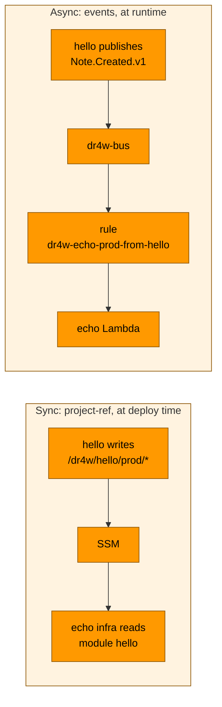
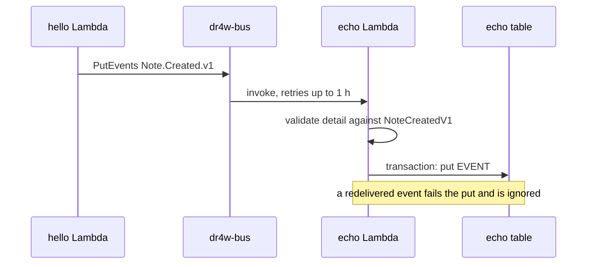

# 08 · Connecting projects

> **In one sentence:** a project can read another project's published settings, or — preferably — react to its events on the shared bus, but only after the other project explicitly allows it.
> **Reading time:** ~10 min · **Level:** 🟢 beginner-friendly, 🔵 expert section marked

## Why this matters
Small projects become more useful together: one stores notes, another counts them, a third could
email a digest. Without rules, they'd reach into each other's databases and break whenever one
changes. dr4w gives them two safe, documented ways to cooperate.

## The idea, simply
Two ways neighbours can cooperate:
- **Reading a notice board (sync).** Each project pins its address and table name on a public
  board (SSM). Another project can read the board — like looking up a phone number.
- **A bell in the hallway (async).** When something happens, a project rings the shared bell
  (publishes an **event** on the **event bus**). Anyone who signed up for that sound reacts in
  their own time. The one ringing doesn't wait and doesn't need to know who listens.

The bell is preferred: projects stay independent. And in both cases the owner decides who may
listen or read — through `exposes` in its `project.json`.

## How it works in dr4w
Notice the difference: the sync path happens at deploy time and reads names; the async path happens at runtime and carries data.


### 1. Permission first
```jsonc
// apps/hello/project.json — the provider grants
"exposes": { "echo": ["events"] }
// apps/echo/project.json — the consumer declares
"uses": ["hello"]
```
`pnpm check:projects` (also in CI) fails if these don't match, and the OpenTofu modules fail at
plan time if the grant is missing. Possible grants: `events`, `table:read`, `table:write`,
`bucket:read`, `queue:send` (schema in `scripts/lib/projects.ts`).

### 2. The event contract
`packages/contracts/src/events/hello.ts` defines `NoteCreatedV1`: source `dr4w.hello`,
detail-type `Note.Created.v1`, and a zod schema for the detail (`id`, `title`, `createdAt`). The
`v1` is part of the name: a breaking change becomes `v2`, published alongside `v1` until every consumer moves.

### 3. The event's journey

- Provider side: `publish(NoteCreatedV1, …)` in `apps/hello/api/src/routes/notes.ts`, allowed by
  `publishes_events = true` in `apps/hello/infra/main.tf`.
- Consumer side: `onEvent(NoteCreatedV1, …)` in `apps/echo/api/src/events.ts`, subscribed by
  `module "from_hello"` in `apps/echo/infra/main.tf`.
- Same Lambda: echo's single function handles both HTTP and events — `createLambdaHandler`
  tells them apart (`docs/decisions/0011-single-lambda-handles-events.md`).

### 4. Locally
`pnpm dev hello echo` makes hello's `publish()` POST the same envelope to echo's dev-only route
`/api/_events` (wired by `scripts/dev.ts` from `uses`/`exposes`).

## Try it
```bash
pnpm dev hello echo
curl -s localhost:5174/api/count
curl -s -X POST localhost:5173/api/notes -H 'content-type: application/json' -d '{"title":"event test"}'
curl -s localhost:5174/api/count
```
Expected: `count` goes up by one and `lastTitle` is `"event test"`. Stop with Ctrl-C.

## 🔵 Expert notes
- **Delivery semantics:** EventBridge is at-least-once; the target retry policy allows 10 retries
  within 1 hour (`infra/modules/event-subscription/main.tf`). No DLQ is configured on the target
  yet — after an hour a failing event is dropped from delivery, but the 7-day archive can replay it.
- **Ordering:** not guaranteed. echo stores `lastTitle` from the latest *delivered* event, not the latest created note.
- **Coupling:** the consumer depends only on the contract package and the bus; renaming hello's
  table breaks nobody. `project-ref` *does* couple to names, so it returns only String outputs and
  only grants what `exposes` lists — never SecureStrings.
- **Publish failure:** hello awaits `PutEvents`; if it fails, the request fails after the note is
  saved (no outbox). Acceptable for v1; an outbox or DynamoDB Streams would make it exactly-once-publish.
- **Gap:** SQS consumers aren't dispatched by `createLambdaHandler` yet (`docs/STATUS.md`).

## Common mistakes
- Hardcoding another project's table name — `docs/dos-and-donts.md` → Cross-project.
- Changing an event's detail shape in place instead of adding `v2`.
- A handler that isn't idempotent (`docs/dos-and-donts.md` → Data).

## Check yourself
1. Who decides whether `echo` may receive `hello`'s events, and where?
2. Why is the event called `Note.Created.v1` and not just `NoteCreated`?
3. What protects echo's counter from counting a redelivered event twice?

<details><summary>Answers</summary>

1. `hello`, the provider, in `apps/hello/project.json` → `exposes`.
2. The version is part of the contract: a breaking change gets a new name (`v2`) so old consumers keep working.
3. The transaction that writes `EVENT#<id>` with a "must not exist" condition together with the counter update.
</details>

## Learn more
`docs/guides/connect-projects.md` (checklist) · EventBridge retries: https://docs.aws.amazon.com/eventbridge/latest/userguide/eb-rule-dlq.html ·
next: [09 · Security](09-security.md)
