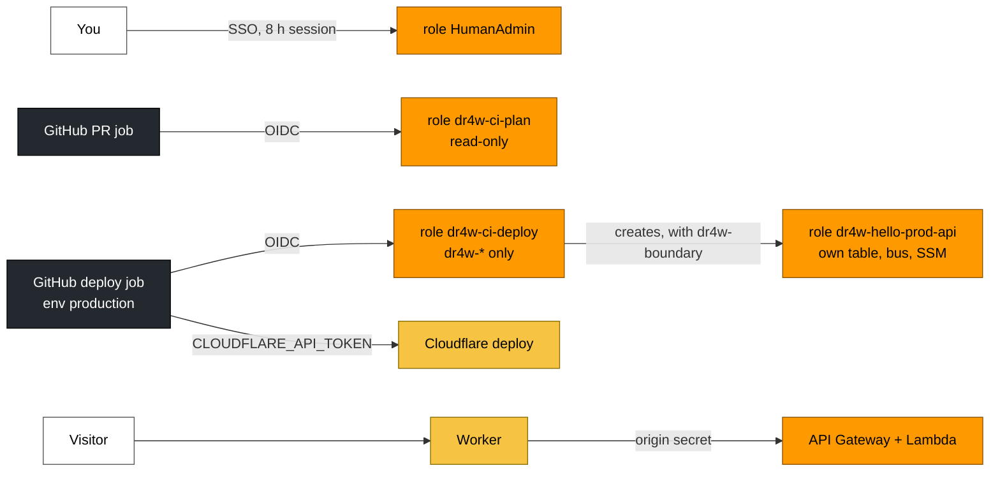

# 09 · Security

> **In one sentence:** AWS access needs no long-lived keys — people sign in with SSO, robots get short-lived tokens through OIDC — and each role is scoped to dr4w; the remaining long-lived credential is the Cloudflare deploy token.
> **Reading time:** ~11 min · **Level:** 🟢 beginner-friendly, 🔵 expert section marked

## Why this matters
The repo is public and the AWS account is shared with other work. A leaked key or an over-powered
robot could cost money or data. The design goal is that there is nothing long-lived to leak, and
that each part can do as little damage as possible.

## The idea, simply
- An **access key** is like a house key you copy and carry around: if it's lost, anyone can use it
  until you change the locks. dr4w avoids them.
- **SSO** (single sign-on) is like a hotel key card printed at the desk: you prove who you are,
  get a card that works for a few hours, and it expires by itself.
- **OIDC** gives the same kind of short-lived card to GitHub's robots: GitHub vouches "this job is
  running in repo `Dr4wOne/dr4w`, environment `production`", and AWS hands out a temporary card.
- **IAM roles and policies** are the list of doors a card opens. **Least privilege** means each
  card opens only the doors that job needs.
- A **permissions boundary** is a ceiling: even if someone writes "open all doors" on a card, it
  can never open more than the ceiling allows.

## How it works in dr4w
Notice that no arrow carries a stored AWS key, and that the browser never reaches AWS without the Worker.


| Who | How it signs in | What it can do |
|---|---|---|
| You (laptop) | `aws sso login --profile dr4w` → role `HumanAdmin` | everything; only place bootstrap is applied |
| PR checks | OIDC → `dr4w-ci-plan` | can't change anything — but AWS's `ReadOnlyAccess` can *read* every S3 object and DynamoDB item in the shared account, including state with the origin secrets |
| Deploys | OIDC → `dr4w-ci-deploy`, only for jobs in the `production` environment | create/change `dr4w-*` resources; every role it creates must carry `dr4w-boundary`; can't touch its own role, the boundary or the state bucket's settings |
| hello's Lambda | its role `dr4w-hello-prod-api` | its own table, the bus, its own SSM parameters |

The roles are defined in `infra/bootstrap/ci-roles.tf` and the ceiling in
`infra/bootstrap/boundary.tf`. The OIDC trust uses the repo's **immutable** identity
(`repo:Dr4wOne@279559492/dr4w@1420042428:…` — GitHub's fixed numeric IDs for the owner and the repo),
so a different repo with the same name gets nothing. In IAM words: a role's *trust* policy says who
may *assume* it (put on that key card); `ReadOnlyAccess` is AWS's built-in "look, don't touch" policy.

**Secrets** and where they live (full list: `docs/security.md`):
- the Worker ↔ API **origin secret**: SSM SecureString + Worker secret;
- the **Cloudflare API token**: a GitHub environment secret, only visible to deploy jobs;
- local dev uses a fixed, harmless `dev-origin-secret` in git-ignored files.

**Abuse protection:** someone who finds the AWS URL can't get past the secret (they get `403`). API
Gateway throttling (50 requests/s, burst 100 per project) limits the *rate*, not the bill: requests
refused by the secret check (`403`) still run the Lambda, so a sustained flood could cost on the order of $185/month per project,
and the $10 budget only sends email. Rate limiting in Cloudflare and an automatic stop are in the backlog.

## Try it
```bash
pnpm run doctor
curl -s -o /dev/null -w '%{http_code}\n' "$(AWS_PROFILE=dr4w aws ssm get-parameter --name /dr4w/hello/prod/api_url --query Parameter.Value --output text)/api/notes"
```
`pnpm run doctor` checks your tools' versions, Docker, your AWS SSO session, GitHub login, the
Claude plugins, and whether long-lived AWS keys exist on the machine.
Expected: `doctor` lists your SSO session (or tells you to `aws sso login --profile dr4w`) and
warns about any long-lived keys it finds; the `curl` to the raw AWS URL prints `403`.

## 🔵 Expert notes
- **CI separation:** PR jobs can't assume the deploy role (its trust allows only
  `environment:production`, which deploys only from `main`). Fork PRs get no OIDC token at all;
  Dependabot PRs skip the plan job for the same reason.
- **Privilege escalation guard:** `iam:CreateRole`/`PutRolePolicy` require
  `iam:PermissionsBoundary = dr4w-boundary`; explicit denies cover `dr4w-ci-*` roles, the boundary
  and `DeleteRolePermissionsBoundary`. Simulated with the IAM policy simulator on 2026-10-15.
- **Known gaps (backlog in `docs/STATUS.md`):** the plan role is trusted by any same-repo PR or branch
  and has account-wide read access, so a PR that edits `ci.yml` can read data and state; the deploy
  role could delete old state versions; build steps run *after* AWS credentials are loaded, so a
  malicious dependency script would get them; the Cloudflare token is long-lived and can edit DNS
  for the whole `dr4w.io` zone; the origin secret is a static bearer token (rotation = a short 403
  window). The `production` environment's branch rule and branch protection are GitHub settings, not code.
  No user authentication exists in v1, so the API is writable by any visitor.
- **Shared-account risk** (`docs/STATUS.md` → Known issues): an unrelated role `gha-sandbox` trusts
  every `Dr4wOne` repo's `main`; narrowed policies are prepared but not applied (accepted for now).
- **Public repo hygiene:** secret scanning + push protection on; nothing secret is committed; the account ID is not a secret.

## Common mistakes
- Creating IAM access keys "just for a script" — use `AWS_PROFILE=dr4w` (`docs/setup-new-machine.md`).
- Putting a secret in `wrangler.jsonc` `vars` — `docs/dos-and-donts.md` → Secrets.
- Wildcard IAM actions in a module — `docs/dos-and-donts.md` → Infra.

## Check yourself
1. Why does a pull request's CI job never get permission to deploy?
2. What stops the deploy role from creating an all-powerful role?
3. What happens if someone calls the AWS API URL directly?

<details><summary>Answers</summary>

1. The deploy role trusts only jobs in the `production` environment, which runs only on `main`.
2. Every role it creates must carry `dr4w-boundary`, the ceiling that excludes IAM and limits access to `dr4w-*` resources.
3. `403` — the request has no origin secret — and API Gateway throttling caps how often they can try.
</details>

## Learn more
`docs/security.md` · `docs/guides/secrets.md` · GitHub OIDC with AWS:
https://docs.github.com/en/actions/security-for-github-actions/security-hardening-your-deployments/configuring-openid-connect-in-amazon-web-services ·
IAM permissions boundaries: https://docs.aws.amazon.com/IAM/latest/UserGuide/access_policies_boundaries.html ·
next: [10 · Costs](10-costs.md)
