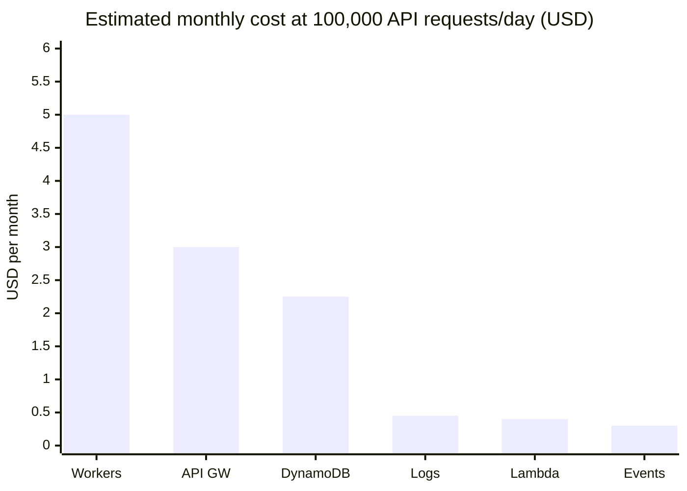

# 10 · Costs

> **In one sentence:** dr4w only uses services that bill per use, so an idle project costs close to $0; costs grow with requests, and the guardrails keep surprises small.
> **Reading time:** ~9 min · **Level:** 🟢 beginner-friendly, 🔵 expert section marked

## Why this matters
dr4w exists to run many small ideas. That only works if each one costs nothing while it waits for
its first users. Knowing what is billed also tells you which design choices are expensive.

## The idea, simply
Compare a taxi with owning a car. A car (a rented server) costs money every month even when
parked. A taxi (serverless) costs nothing until you ride, then a little per trip. dr4w takes
taxis everywhere: Lambda runs only when a request arrives, DynamoDB charges per read and write,
Cloudflare serves the pages for free.

## How it works in dr4w
Idle cost per item, from `docs/costs.md` (estimates, last checked 2026-10-15; the measured number
is still pending in `docs/STATUS.md`):

| What | Idle | Grows with |
|---|---|---|
| Lambda | $0 | requests and run time |
| API Gateway HTTP API | $0 | requests |
| DynamoDB on-demand | ~$0 (cents of storage) | reads, writes, GB stored |
| CloudWatch logs and alarms | ~$0 (first 10 alarms free; 2 per project) | log volume, alarm count |
| EventBridge, S3, SSM, SNS, Budgets | ~$0 | events, bytes |
| Cloudflare Workers (Free plan) | $0 | `/api/*` requests (100,000/day limit; static files are free and unlimited) |
| Aurora Postgres (**off**) | ~$1–3/month when on | storage, active minutes |

**Today, idle, hello + echo + platform ≈ $0.00–0.10 per month.**

Guardrails built in:
- API Gateway throttling: 50 requests/s, burst 100 per project (`infra/modules/project-api/variables.tf`).
- Log retention ≤ 14 days, enforced by a validation rule in the same module.
- Pay-per-request only: no load balancers, NAT gateways, servers in a private network or dashboards.
- `dr4w-monthly` budget: $10, email at 50/80/100% and when the forecast exceeds 100% (`infra/platform/main.tf`).

### What if traffic grows 100×?
An estimate, assuming each API request = 1 DynamoDB read + 1 write, 100 ms at 512 MB, and 1 event per 10 requests.
Prices are us-east-1 list prices checked on 2026-10-15 (marked † where the page didn't show the number and the usual list price is used).

| Item | Small: 1,000 API requests/day | 100×: 100,000/day |
|---|---|---|
| Lambda requests ($0.20/M after 1M free) | $0 | $0.40 |
| Lambda compute (150k GB-s — memory in GB × seconds run — under 400k free) | $0 | $0 |
| API Gateway HTTP API (~$1.00/M †) | $0.03 | $3.00 |
| DynamoDB writes ($0.625/M) + reads ($0.125/M) | $0.02 | $2.25 |
| EventBridge events (~$1.00/M †) | $0.00 | $0.30 |
| CloudWatch logs (~0.3 KB/request, ~$0.50/GB †) | $0.00 | $0.45 |
| Cloudflare Workers (`/api/*` counts; static files free) | $0 | $5 (Paid plan, at the 100k/day limit) |
| **Total / month** | **≈ $0.05** | **≈ $11.40** |

(Lists cost more than "1 read": a hello list call reads the whole partition, up to 128 read units per 1 MB.)
Notice that at 100× the biggest items are the Workers plan, API Gateway and DynamoDB — and that the total passes the $10 budget, so you'd get an email before it becomes a problem.

## Try it
Billing → **Cost Explorer** → last 30 days → group by *Service*; then filter by *tag* (a label
OpenTofu puts on every dr4w resource) `managed-by = opentofu` and group by tag `project` (`docs/costs.md` explains activating the tag).
Expected: dr4w's services in cents.

## 🔵 Expert notes
- **Free tiers are account-wide.** The account is shared with other work, so Lambda's free tier
  may already be used up by something else; the 100× column then grows by ~$0.20 (requests) + compute.
- **Biggest levers at scale:** API Gateway per-request cost (a Lambda function URL or Workers →
  Lambda via a signed request would remove it, at the price of the current design's simplicity);
  DynamoDB access patterns (avoid scans; transactions cost double).
- **Alarms** are the first item to cost money as projects multiply: 2 per project, free up to 10.
- **Aurora** is the only "cost while idle" item, which is why it's off by default. "~$1–3" assumes
  it stays paused: anything that queries it more often than every 5 minutes keeps it awake, at least
  0.5 ACU × 730 h ≈ $40+/month (`docs/decisions/0015-postgres-via-data-api.md`).
- **Abuse is the real cost risk:** throttling caps the rate at 50 requests/s, which is still
  ~130 M requests/month — roughly $185/month in API Gateway, Lambda and logs per project. The budget
  only emails; nothing stops traffic automatically yet.
- **Emergency stop:** set the Lambda's reserved concurrency (how many copies may run at once) to 0 (`docs/costs.md`); the static site keeps working.

## Common mistakes
- Adding "just one" NAT gateway or load balancer — each has a fixed monthly floor (`docs/dos-and-donts.md` → Infra).
- Reading the budget email as "dr4w costs this much" — the budget covers the whole shared account.

## Check yourself
1. Why does an idle project cost almost nothing?
2. Which guardrail limits the cost of someone hammering the API?
3. At 100× traffic, which line item would you look at first, and why?

Answers

1. Every service bills per request or per byte, and none runs (or bills) while there are no requests.
2. API Gateway throttling (50 requests/s, burst 100) per project.
3. The Workers plan (a fixed $5 step) or API Gateway (the largest per-request item) — both scale with every API call.

## Learn more
`docs/costs.md` · Lambda pricing: https://aws.amazon.com/lambda/pricing/ · API Gateway pricing: https://aws.amazon.com/api-gateway/pricing/ ·
DynamoDB on-demand pricing: https://aws.amazon.com/dynamodb/pricing/on-demand/ · Workers pricing: https://developers.cloudflare.com/workers/platform/pricing/ ·
next: [11 · Shipping and running](11-shipping-and-running.md)
