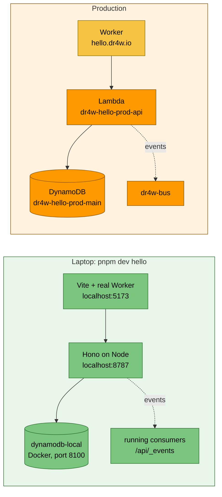
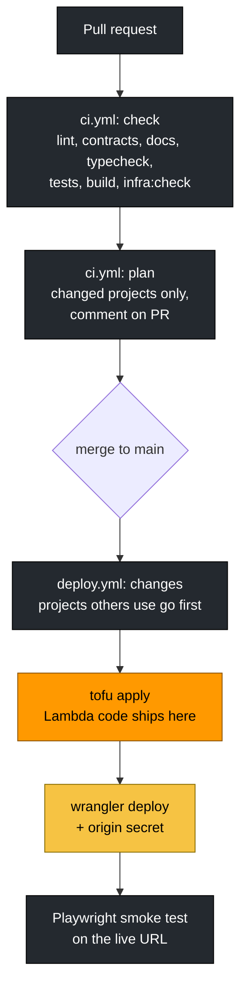
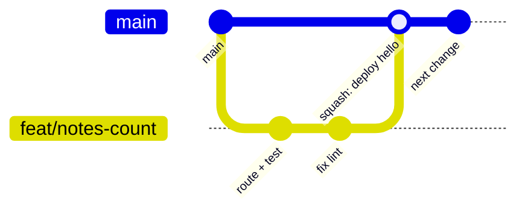

# 11 · Shipping and running

> **In one sentence:** you work locally with `pnpm dev`, open a pull request that robots test and plan, and merging it deploys and smoke-tests the changed projects; logs, alarms and a few workflows cover the rest.
> **Reading time:** ~13 min · **Level:** 🟢 beginner-friendly, 🔵 expert section marked

## Why this matters
"Works on my machine" isn't enough, and "deploy" shouldn't mean a checklist of manual steps.
dr4w makes the local setup look like production and makes merging the only way to ship.

## The idea, simply
Think of a restaurant kitchen with a strict routine:
- you cook a test plate in the **test kitchen** (your laptop, `pnpm dev`);
- the head chef checks every new recipe card before it goes on the menu (**CI on the pull request**);
- once approved, the recipe goes to the real kitchen, and a taster checks the first plates that
  guests are already getting (**deploy, then a smoke test on the live site** — there is no staging
  step and no automatic rollback);
- if a dish goes wrong, you put the previous recipe card back (**rollback**).

## How it works in dr4w

### Local development
Notice that every production piece has a local stand-in, and the Worker and API code are the same.

`scripts/dev.ts` starts Docker's dynamodb-local, creates the tables from `tables.json`, then runs
each project's API (`tsx watch src/local.ts` — runs TypeScript and restarts on save) and web
(`vite`, which runs `worker/index.ts` in *workerd*, Cloudflare's Worker runtime, on your laptop). `pnpm dev:cloud <p>` keeps the local servers but points the API at the
**real** AWS table, for debugging with real data: reads are safe, writes change production, and
events are only logged (never sent to the real bus). Details: `docs/guides/local-dev.md`.

### Pull request → merge → deploy
Notice that the plan is shown on the PR before anything changes, and that only `main` deploys.

- **Changed-project detection** (`scripts/changed-projects.ts`): files under `apps/<p>/` change
  `<p>`; anything under `packages/` or `infra/modules/` (or the lockfile) changes **every**
  project. The list is sorted so providers deploy before their consumers.
- **Branch protection:** `main` only accepts changes through PRs whose `check` and `plan` passed.
- **Smoke tests:** `apps/<p>/web/e2e/smoke.spec.ts` runs against `https://<sub>.dr4w.io` after every deploy.
- **If a deploy fails,** nothing retries it: fix forward or rerun it (`gh workflow run deploy.yml -f project=<p>`).

The branch flow in practice — notice that every change reaches `main` as one squashed commit:


### Running in production
| Need | Where |
|---|---|
| Logs | `aws logs tail /aws/lambda/dr4w-<p>-prod-api` — one JSON line per request (`docs/guides/debugging-prod.md`) |
| Alarms | `dr4w-<p>-prod-api-errors`, `-5xx` → email via `dr4w-alerts` |
| Roll back | revert PR (normal case), or re-run an older deploy run when you need it back *now* — which also reverts infra and can delete resources added since (`docs/guides/rollback.md`) |
| Shared infra change | `platform.yml`, plan first, then apply (`docs/guides/deploy.md`) |
| Remove a project | `destroy.yml` (`docs/guides/destroy-project.md`) |
| Rotate secrets | `docs/guides/secrets.md` |

## Try it
```bash
pnpm check
pnpm changed --all
```
Expected: `pnpm check` runs the same checks as CI and ends with all tasks successful;
`pnpm changed --all` prints `["hello","echo"]` — the deploy order (hello first, because echo uses it).

## 🔵 Expert notes
- **Deploy order and concurrency:** the deploy *matrix* (one job per changed project) runs with `max-parallel: 1` in dependency
  order and a per-project concurrency group, so one project's state is never applied twice at once.
- **Atomic Worker release:** `wrangler deploy --var API_ORIGIN:… --secrets-file …` uploads code,
  the API address and the origin secret as one version.
- **First deploy of a domain** waits for Cloudflare to issue the certificate (the workflow polls
  `/api/health` for up to 5 minutes before the smoke test).
- **What's not covered:** no canary or blue/green (a bad deploy is fixed by a fast revert); no PR
  previews (`docs/decisions/0014-no-pr-previews.md`); docs-only changes deploy nothing.
- **Pinned supply chain:** third-party actions pinned to commit SHAs; Dependabot with a 3-day cooldown
  matching pnpm's release-age rule. Gap: builds run after AWS credentials are loaded (backlog).
- **Partial deploys:** with `fail-fast: false`, a shared change can reach `hello` and fail on `echo`; a
  failed deploy isn't retried, and the next push deploys only *its* changed projects — prod can lag
  `main` until you run `gh workflow run deploy.yml` (all projects).
- **Local fidelity limits:** dynamodb-local is in-memory and not identical to DynamoDB (e.g. throttling
  and IAM aren't simulated); events are delivered by HTTP, not EventBridge (no retries or archive).

## Common mistakes
- Pushing to `main` directly — blocked; use a PR (`docs/conventions.md` → Git).
- Ignoring the plan comment. Read it: unexpected deletes are the signal to stop.
- Testing writes with `pnpm dev:cloud` — it writes to production data.

## Check yourself
1. A PR changes only `packages/contracts/`. Which projects deploy after merge?
2. Why can't a pull request's CI job deploy?
3. What runs after the Worker is deployed, and against what?

<details><summary>Answers</summary>

1. All of them — shared packages affect every project.
2. Deploys need the `production` environment, which only runs on `main`, and the deploy role trusts nothing else.
3. The Playwright smoke test, against the live `https://<subdomain>.dr4w.io`.
</details>

## Learn more
`docs/guides/deploy.md` · `docs/guides/local-dev.md` · GitHub Actions: https://docs.github.com/en/actions ·
Playwright: https://playwright.dev · next: [12 · The idea pipeline and AI workflow](12-idea-pipeline-and-ai.md)
