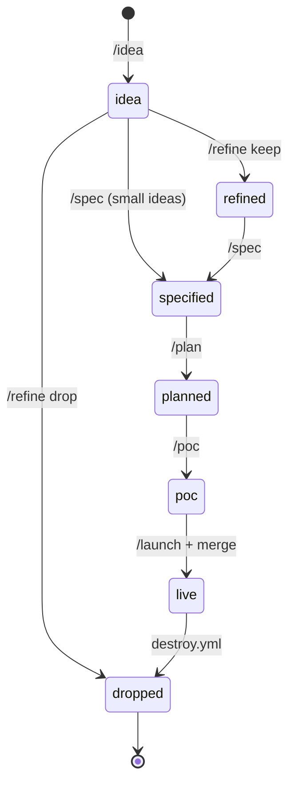

# 12 · The idea pipeline and AI workflow

> **In one sentence:** ideas move through written stages — idea, refine, spec, plan, POC, launch — driven by Claude slash commands, and everything worth remembering is written into the repo, not left in a chat.
> **Reading time:** ~10 min · **Level:** 🟢 beginner-friendly, 🔵 expert section marked

## Why this matters
An AI assistant can write a lot of code quickly — including code nobody asked for. The pipeline
keeps it pointed at the right problem: first decide *what* and *why* in plain documents, then
build only that. And because each session starts with no memory, the repo itself has to hold the context.

## The idea, simply
Building with dr4w is like building a house with an architect:
1. you describe the idea on a napkin (**idea**),
2. the architect asks a few sharp questions (**refine**),
3. they draw the plans (**spec**) and a work schedule (**plan**),
4. a quick prototype room is built (**POC**, proof of concept),
5. the house opens (**launch**).

Nobody pours concrete before the plans exist. This is **spec-driven development**: specs first, code second.

## How it works in dr4w
Notice that every stage writes a file, and that an idea can be dropped early, before any code exists.

| Stage | Command | Writes | Guardrail |
|---|---|---|---|
| Capture | `/idea <one-liner>` | `ideas/<slug>/00-idea.md` | no code, no questions yet |
| Sharpen | `/refine <slug>` | rewrites `00-idea.md` | ≤ 7 questions, then keep or drop |
| Specify | `/spec <slug>` | `01-spec.md` | infra only from `infra/modules/README.md`; no login |
| Plan | `/plan <slug>` | `02-tasks.md` | tasks ≤ 1 hour, each with its test |
| Build | `/poc <slug>` | code in `apps/<p>/` | `pnpm check` green, `pnpm dev` works; nothing touches the cloud |
| Ship | `/launch <slug>` | a pull request | checklist, then a human "go" before merging |

Each command is a short instruction file in `.claude/commands/` (for example
`.claude/commands/spec.md`). Two more work outside the pipeline: `/endpoint <project> <METHOD /path>`
adds one API endpoint with its schema and test, and `/resource <project> <kind>` adds a table,
queue, bucket, cron schedule or event subscription. `pnpm ideas` prints the board from the `status` in each `00-idea.md`.
The real worked example is `ideas/guestbook/`.

### How Claude is used here
- **`CLAUDE.md`** is loaded at the start of every session: the stack, the "never" list, the commands, and
  a "read X when Y" index that points to the right doc instead of loading everything.
- **`apps/<p>/CLAUDE.md`** is loaded when working inside one project.
- **Session protocol:** `/start` gives a 5-line briefing from `docs/STATUS.md` and git;
  `/handoff` writes what was learned back into `docs/STATUS.md`, ADRs and docs; `/where` finds
  files; `/doc-check` fixes docs a change made stale.
- **The repo is the memory:** decisions go into `docs/decisions/`, current state into `docs/STATUS.md` — so they travel with `git clone`.
- **Human gates:** Claude never applies infrastructure, deploys or merges without an explicit "go" (`CLAUDE.md` → Never).

### caveman and ponytail
Two plugins are enabled for this repo (`docs/agent-tools.md`):
- **caveman** makes chat replies short. Files people read (docs, specs, ADRs, PR texts) stay in plain, complete English.
- **ponytail** makes Claude write only the code a task needs — but it may never cut input
  validation, the origin-secret check, IAM least privilege, tests or accessibility. It runs inside
  the pipeline: `/spec` and `/plan` still write full documents; ponytail limits how much code
  `/poc` and `/endpoint` produce. `/ponytail-review` runs before merging, `/ponytail-debt` before `/launch`.

## Try it
```
/idea a page that shows today's most popular note
```
Then `pnpm ideas`. Expected: a new folder under `ideas/` with a filled-in `00-idea.md`, listed
with status `idea`. Nothing else changes — delete the folder if you don't want to keep it.

## 🔵 Expert notes
- **Why specs first with an AI:** the spec is the reviewable unit. It's cheaper to correct a
  one-page spec than generated code, and `/spec`'s "catalog modules only" rule keeps infra predictable.
- **Context economy:** `CLAUDE.md` is ≤ 80 lines with pointers rather than `@imports`; reference
  docs follow "one home per fact" so an agent reads one file per question (a cold-start test on
  2026-10-15 answered 6 questions with ≤ 4 files each).
- **Measured speed:** the guestbook dry run went from `/idea` to verified live in 12 m 39 s — most
  of it CI (~3 min) and deploy (~6 min); `/endpoint` took ~30 s.
- **Plugin trust:** both plugins run local *hooks* (small scripts Claude Code runs on events such as each prompt) on every prompt; they were reviewed for network
  access and pinned to release tags (`docs/decisions/0017-caveman-and-ponytail-by-default.md`).
- **Limits:** the pipeline assumes one owner; there's no multi-reviewer approval flow, and `/refine` needs a human to answer.

## Common mistakes
- Jumping from `/idea` to code, skipping `/spec`.
- Leaving a decision only in the chat — run `/handoff` (`docs/dos-and-donts.md` → Docs).
- Expecting caveman's short style in docs; docs follow `docs/conventions.md` → Docs.

## Check yourself
1. Which stage first produces code, and which stage first touches the cloud?
2. What does `/handoff` do, and why does it matter?
3. Name two things ponytail is never allowed to cut.

<details><summary>Answers</summary>

1. `/poc` produces code (locally only). The PR from `/launch` is the first contact with AWS — its plan job reads, with a read-only role — and merging it is the first change.
2. It writes the session's state, decisions and lessons into `docs/STATUS.md`, ADRs and docs, so the next session (or person) starts with that context.
3. Any two of: input validation, the origin-secret check, IAM least privilege, tests for logic, accessibility.
</details>

## Learn more
`ideas/README.md` · `docs/guides/new-idea.md` · `docs/agent-tools.md` · Claude Code slash commands:
https://code.claude.com/docs/en/slash-commands · next: [13 · Tutorials](13-tutorials.md)
